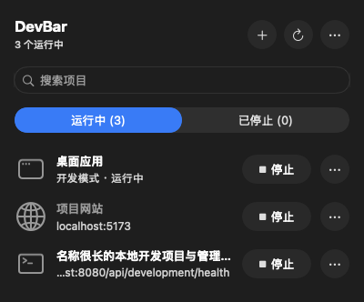

# DevBar

DevBar 是 macOS 菜单栏里的本地项目启动器。把用 AI 做的网站、应用和本地服务集中在一起，随时运行、打开或停止。

[产品官网](https://bavoch.github.io/DevBar/) · [版本发布](https://github.com/Bavoch/DevBar/releases) · [报告问题](https://github.com/Bavoch/DevBar/issues) · [MIT 许可证](LICENSE)



## 安装

当前公开版本提供源码。需要 macOS 13 或更新版本，以及 Swift 5.9 或更新版本的 Xcode Command Line Tools。

```sh
git clone --branch v0.16.0 https://github.com/Bavoch/DevBar.git
cd DevBar
zsh scripts/build.sh
```

构建完成后，把 `dist/DevBar.app` 拖进「应用程序」，打开 DevBar，再从菜单栏进入。源码构建使用本机临时签名。正式下载包将在完成 [Apple 签名与公证](docs/release.md) 后提供。

DevBar 无需账户。日常使用无需 Node 或终端，具体项目所需的运行环境仍需安装。项目列表和日志保存在本机。

## 使用

1. 点击菜单栏中的 DevBar，再点 **＋**，选择项目文件夹。
2. 点 **运行**。DevBar 优先使用项目已有的本地启动方式。
3. 网页或应用可用后，点击项目名称打开。
4. 点 **停止** 结束该运行方式；日志、其他运行方式、目录和设置在 **更多** 中。

项目显示在菜单栏面板中，运行中的项目排在前面。顶部可添加、刷新和搜索；每行显示项目名称与状态，右侧可直接运行或停止，更多操作使用系统菜单。普通启动在后台执行项目原命令，不打开终端；输出保存在项目日志中。通过面板运行或重启后，网页或应用入口就绪时自动打开一次；纯后台服务与脚本保持后台运行。启动、失败、已停止会直接显示；运行失败可重试。源码监听和热更新完全交给项目原本的开发工具；DevBar 只管理启动、停止和状态，不额外重启、包装或重签项目。

不需要了解进程号、端口分类、适配器或版本证明。只有自动识别不到入口时，才需要在设置里填写启动命令；也可以让 AI 根据项目说明帮你确认。

## 操作边界

- 添加和发现项目不会运行脚本、安装依赖或执行部署。
- 运行中的项目使用同一套打开、停止和重启操作。停止或重启后，项目会保留在列表，方便再次运行。
- 停止、重启前核对项目归属与进程身份，保护终端、AI 工具和无关服务，不根据项目名称或目录批量关闭进程。
- 项目有多个运行方式时，主停止按钮结束本项目的全部受管方式；在更多菜单中可以分别运行和停止。移除前需先停止由 DevBar 启动的运行方式；移除不删除项目文件。
- 退出 DevBar 会保留正在运行的项目。再次打开后可继续管理。
- 安装版应用发生冲突时会提示处理，不会自行关闭或替换安装版。

“运行中”表示本地命令或应用正在运行，不代表页面功能、登录、数据库或 AI 生成的代码已经通过验收。无法自动确认的入口不会伪装为可用。

## 项目范围

自动识别常见 Web、API、Node、Python、Swift、Rust、Go、静态网页、Electron、Tauri 等项目的已有入口，以及工作区中的子项目。识别结果取决于项目声明和本机环境，不保证任意目录都能直接运行。

手机应用、浏览器插件、小程序、容器和宿主插件需要相应设备、工具或专用配置。它们的支持边界与验证条件见 [平台说明](docs/platform-matrix.md)。库、素材和备份目录不会被强行创建运行入口。

## 数据与开发

项目列表和日志保存在 `~/Library/Application Support/DevBar`。移除列表记录不会删除项目，升级 App 会保留列表和日志。分享诊断信息前，请检查项目日志里可能含有的敏感内容。

想开发 DevBar 时，在安装 Node/npm 后运行 `npm run dev`。源码变更会触发重新编译并重启开发实例。用 `npm run dev:status` 查看状态，或运行 `npm run dev:stop` 停止开发会话。

[贡献指南](CONTRIBUTING.md) · [安全报告](SECURITY.md) · [变更记录](CHANGELOG.md)

## 可选命令行

普通使用无需 CLI。集成工具可通过应用包内的 `Contents/Resources/install-cli.sh` 安装命令行入口；已有同名工具不会被覆盖。

- `devbar doctor <目录>`：只读检查运行条件。
- `devbar inventory <目录>`：只读盘点项目。
- `devbar init <目录> --plan`：查看配置草稿，不执行项目。
- `devbar sync <目录> --target <ID>`：按所选配置运行；普通进程目标使用同一套持续运行流程。
- `devbar status <目录> --target <ID>`：检查运行状态。
- `devbar stop <目录> --target <ID>`：停止对应受管运行方式。

`.devbar.json` 是可执行配置，应先审阅再运行。安装包更新、远程设备与宿主驱动属于显式配置的高级集成，不参与普通运行的自动推断。完整协议见 [集成说明](docs/sync-contract.md)。
